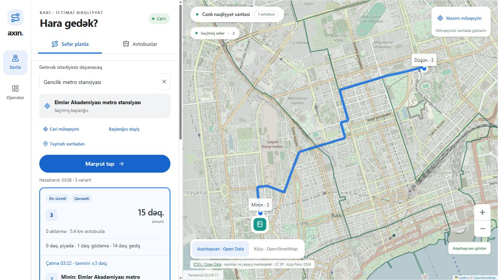
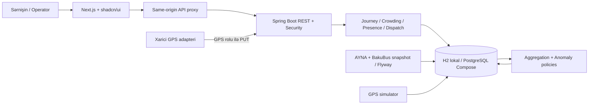

# Axın — Smart Transit & Crowdsourcing Engine

**Digital Challenge Azerbaijan 2026 · Yarımfinal · 31.10.2026**

Bakı üçün səfər planlayıcısı, hərəkətli avtobus xəritəsi, sərnişin sıxlıq bildirişləri və operator analitikası. Java/Spring Boot və Next.js/TypeScript tətbiqləri feature-based strukturla hazırlanıb.



## Təhvil materialları

| Material | Fayl |
|---|---|
| Mənbə kodu | backend/, frontend/, scripts/, compose.yml |
| Quraşdırma və arxitektura | Bu README |
| AI alətləri və promptlar | [AI Declaration](docs/AI_DECLARATION.md) |
| Texniki izah — UTF-8, Notepad/Word | [TECHNICAL_EXPLANATION.txt](docs/TECHNICAL_EXPLANATION.txt) |
| Qəbul meyarları və nümayiş | [ACCEPTANCE.md](docs/ACCEPTANCE.md) |
| Faktiki yoxlama tarixçəsi | [VERIFICATION.md](docs/VERIFICATION.md) |
| Dataset və lisenziyalar | [DATA_SOURCES.md](docs/DATA_SOURCES.md) |
| API və hesablama | [API.md](docs/API.md), [Journey/ETA](docs/JOURNEY_ETA_AND_OPERATIONS.md) |

## Rəsmi məlumat və simulyasiya

AYNA KMZ-dən **239 marşrut nömrəsi, 243 variant, 270 ayrı həndəsə**, BakuBus CSV-dən **3600 dayanacaq qeydi** idxal edilib. ETSN coğrafi qatı OSM küçə fonunda göstərilir. Dayanacaq–marşrut əlaqəsi 35m yaxınlıqla hesablanan namizəddir; rəsmi xidmət/istiqamət ardıcıllığı deyil.

**Avtobus hərəkəti və ETA simulyasiyadır.** Standart interval 360 saniyə, sürət 23 km/saatdır. Say xəttin tam dövrünə görə hesablanır; lokal nümayişdə operator təyinatları ilə 4211 avtobus görünür. Bu, real Bakı parkının sayı deyil. Bildiriş, alert, iştirak və təyinat tarixçəsi isə həqiqətən DB-yə yazılır. Fiziki avtobusa əmr göndərilmir.

## Lokal başlanğıc

Tələblər: **Java 21 JDK**, **Node.js 24**, Git və ilk dependency yüklənməsi üçün internet. Maven Wrapper repodadır.

Windows PowerShell — layihənin kökündən:

```powershell
# Bir dəfə
cd frontend
npm ci
cd ..

# Terminal 1 — JAVA_HOME Java 21 JDK-a işarə etməlidir
.\scripts\start-backend.ps1

# Terminal 2 — production build + standalone server
.\scripts\start-frontend-production.ps1
```

Standart terminal/macOS/Linux:

```sh
# Terminal 1
cd backend
sh mvnw spring-boot:run

# Terminal 2
cd frontend
npm ci
npm run build
npm start -- --hostname 127.0.0.1
```

Windows Maven əmri `mvnw.cmd spring-boot:run`-dır. Development üçün `npm run dev`, nümayiş üçün production rejimi istifadə edin. Eyni portda iki server işlətməyin. Windows skripti `.tools/` daxilində JDK varsa istifadə edir; bu qovluq repoda yoxdur, başqa kompüterdə `JAVA_HOME` kifayətdir. Skript bəzi Windows MSIX mühitlərində Java pipe problemini proses səviyyəsində həll edir.

| Ünvan / giriş | Dəyər |
|---|---|
| Sərnişin | http://127.0.0.1:3000/ |
| Operator | http://127.0.0.1:3000/operator |
| Backend health | http://127.0.0.1:8080/actuator/health |
| Lokal demo operator | operator / local-demo-change-me |
| Lokal demo GPS | gps / local-gps-change-me |
| Lokal DB | backend/data/transit.mv.db — H2 |

Demo parollarını environment vasitəsilə dəyişin. Backend lokal rejimdə kök `.env` faylını avtomatik oxumur. Serverlər Ctrl+C ilə dayanır; DB faylı qalır.

## Docker Compose

Docker Engine/Desktop və Compose tələb olunur:

```sh
cp .env.example .env
# .env-də DATABASE_PASSWORD, OPERATOR_PASSWORD, TELEMETRY_PASSWORD seçin
docker compose up --build
```

Windows kopyalama əmri: `Copy-Item .env.example .env`. PostgreSQL 17 `transit-data` volume-da saxlanır; `docker compose down` volume-u silmir. 3000/8080 localhost-a bağlıdır, DB host-a açılmır. Bu mühitdə Docker olmadığı üçün Compose/PostgreSQL runtime sınağı aparılmayıb.

| Environment | Standart | Məna |
|---|---|---|
| SIMULATOR_ENABLED | true | Sintetik hərəkət |
| SIMULATION_HEADWAY_SECONDS | 360 | Baza avtobus intervalı |
| SIMULATION_SPEED_KMH | 23 | Simulyasiya sürəti |
| HIGH_DURATION | 10m | Davamlı HIGH müddəti |
| MIN_REPORTERS | 3 | Bildiriş modeli üçün minimum anonim ID |
| NOMINAL_CAPACITY | 60 | GPS iştirak tutumu fərziyyəsi |
| NETWORK_SOURCE | official | demo köhnə fixture-lər üçündür |
| DATABASE_URL | fayl H2 | JDBC bağlantısı |
| BACKEND_URL | http://localhost:8080 | Next.js proxy backend ünvanı |

## İstifadə və təqdimat

1. **Səfər planla:** təyinatı axtarın. Brauzer icazəsi ilə başlanğıc avtomatik alınır; “Başlanğıcı dəyiş” ilə başqa dayanacaq/xəritə nöqtəsi seçilir. localhost və 127.0.0.1 məkan icazələri ayrıdır.
2. Başlanğıcdan 800m daxilində xidmət namizədi olan bütün dayanacaqlar yoxlanılır. Əsas prioritet minimum aktarmadır; birbaşa yol varsa aktarmalı nəticə göstərilmir. Maksimum 3 tövsiyə və uyğun meyar etiketləri verilir.
3. **Ümumi vaxt = piyada + gözləmə + avtobusda gediş + hər aktarmaya 60s.** Sıxlıq çəkisi fiziki vaxta əlavə edilmir. 1 km-dən qısa birbaşa məsafədə piyada variantı göstərilir. “Qənaətli” az minik sayıdır, təsdiqlənmiş tarif deyil.
4. **Avtobuslar:** marşrut/dayanacaq axtarışı, ETA, “Sıxlığı bildir” və ayrıca razılıqla “Bu avtobusdayam · GPS iştirakı”.
5. **Operator:** analitika, HIGH alert-ləri, “Baxıldı”, tam trayektoriya preview-su və konkret ehtiyat avtobusunun təyinatı. Uyğunsuz/artıq təyin edilmiş avtobus və əlaqəsiz həndəsə rədd edilir.
6. **10 dəqiqə demo:** `node scripts/demo-high-load.mjs`. Skript 3 sintetik ID ilə 35 saniyədə bir HIGH bildirir, standart 660s işləyir. DEMO_VEHICLE, DEMO_SECONDS, API_URL dəstəklənir. Sintetik nümayiş olduğunu bildirin.

Xəritə maus/touch, zoom, iki qat, mövqe və dəqiqlik dairəsini dəstəkləyir. Qeyri-dəqiq mövqe ± məsafə ilə göstərilir. 6 dəqiqəlik interval minimum gözləmə deyil: yaxın avtobus varsa gözləmə 0–1 dəqiqə də ola bilər.

## Arxitektura



Backend modular monolith-dir: network, telemetry, journey, crowding, presence, analytics, dispatch, passenger, operator, shared. Frontend: uyğun features/*, routing/proxy üçün app, shadcn primitives üçün components/ui, HTTP üçün lib.

Controller HTTP/validation sərhədi, service istifadə ssenarisi, repository SQL, policy hesablama qaydasıdır. Constructor/Clock injection, parametrli SQL, transaction və ProblemDetail istifadə olunur. Dispatch audit SQL-lərinin bir hissəsi service transaction-ında qalır; sərt hexagonal arxitektura iddiası edilmir.

Statik kataloq bir dəfə, canlı snapshot 3 saniyəlik polling ilə yüklənir. WebSocket/SSE yoxdur. Altı Flyway migration schema, kataloq, iştirak sessiyaları və ehtiyat parkını idarə edir. Əsas ETA/planlama backend-dədir.

## Qaydalar və məhdudiyyətlər

- Bildiriş modeli: son 2 dəqiqə, aktual GPS (60s), hər anonim ID-nin son səsi; minimum 3 ID və 60% HIGH. GPS iştirak modeli nominal tutumun 50%-ində MEDIUM, 80%-ində HIGH verə bilər. Az iştirak avtobusun boş olduğunu sübut etmir.
- HIGH ardıcıl 10 dəqiqə qalanda epizod üçün bir xəbərdarlıq yaranır. TTL və qiymətləndirmə fasiləsi davamlılığı poza bilər. “Baxıldı” sıxlığı dəyişmir.
- Xəritədə mövqe brauzerdə işlənir. Səfər sorğusunda başlanğıc/təyinat koordinatları backend-ə hesablama üçün gedir. GPS iştirakı ayrıca razılıqla koordinat göndərir; presence cədvəli raw koordinat tarixçəsi deyil, təsdiq vəziyyətini saxlayır. OSM tile sorğuları görünən əraziyə görə üçüncü tərəfə gedir.
- PUT /api/telemetry/vehicles/{id} rol, vaxt ardıcıllığı və marşruta yaxınlığı yoxlayır. source=GPS avtobusunu simulator dəyişmir. Real axın qoşulmayıb.
- Ehtiyat avtobus–xətt uyğunluğu lokal simulyasiya bölgüsüdür; rəsmi nəqliyyat vasitəsi icazə reyestri yoxdur.
- Rəsmi cədvəl, trafik, dayanma müddəti və küçə üzrə piyada routing yoxdur. Piyada məsafəsinə 25% dolanma payı, sürətə 1.25m/s fərziyyəsi tətbiq olunur. ETA real trafik dəqiqliyi zəmanəti deyil.
- Anonim ID unikal insan deyil. Production üçün OIDC, TLS, anti-abuse/rate-limit, retention, monitorinq və scheduler lideri tələb olunur. Hazır retention siyasəti yoxdur.
- Mənbənin lisenziyası göstərilmirsə bu ayrıca açıqlanır; public repository üçüncü tərəf dataset hüquqlarını dəyişmir.

## Testlər və faktiki vəziyyət

```sh
cd backend
sh mvnw verify
# Windows: mvnw.cmd verify
cd ../frontend
npm ci
npm test
npm run lint
npm run build
# Serverlər işləyərkən
npm run test:e2e
```

E2E lokal Edge üçündür. Başqa platformada PLAYWRIGHT_CHANNEL=chromium və `npx playwright install chromium` istifadə edin. PostgreSQL integration üçün TEST_DATABASE_URL, DATABASE_USER, DATABASE_PASSWORD yalnız ayrıca disposable bazaya yönəlməlidir; testlər məlumat təmizləyir.

**Status:** əvvəlki mərhələdə 46 backend, 16 frontend unit və 3 operator E2E testi uğurlu olub. Son istiqamət, park və UI dəyişikliklərindən sonra compile/build və seçilmiş əl ilə API/brauzer yoxlamaları aparılıb; istifadəçinin sürət istəyinə görə tam suite təkrar işlədilməyib. Köhnə nəticələr yekun commit üçün bütün testlərin keçdiyi mənasına gəlmir. CI workflow mövcuddur, nəticəsi ayrıca yoxlanmalıdır. [Tarixçə](docs/VERIFICATION.md).

## Data import

```sh
python scripts/import_open_data.py
python -m unittest discover -s scripts -p "test_*.py"
```

Snapshot repodadır; normal startup portalın əlçatanlığından asılı deyil. Import cache .tools/opendata-dadır. Dəyişmiş dataset üçün yeni output/versiya və migration hazırlayın. [Metodologiya və lisenziyalar](docs/DATA_SOURCES.md).

## Təhvil qeydi

Mənbə arxivini GitHub **Code → Download ZIP** ilə də götürmək mümkündür. Layihə funksional müsabiqə prototipidir, rəsmi nəqliyyat xidməti deyil. Təşkilatçıya e-poçt göndərilməsi ayrıca addımdır; bu iş çərçivəsində e-poçt göndərilmir.
